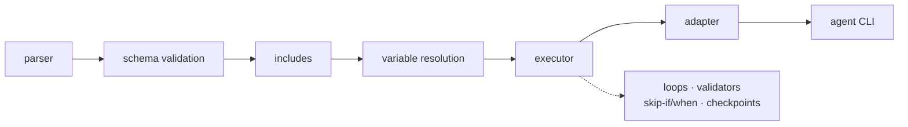

# agent-yaml

Declarative YAML workflows for AI coding-agent CLIs. Define a multi-step workflow once and run it
through OpenCode, Claude Code, Gemini, Qwen, or Codex — the YAML does not change, only the adapter.

Each task is one subprocess invocation of the agent CLI. Tasks communicate through the filesystem,
which keeps runs debuggable, resumable, and independent of any single model or provider.



## Contents

- [Install](#install)
- [Quick start](#quick-start)
- [How it works](#how-it-works)
- [CLI reference](#cli-reference)
- [Visual workflow runner](#visual-workflow-runner)
- [Workflow YAML](#workflow-yaml)
  - [Top-level fields](#top-level-fields)
  - [Tasks: sequential, parallel, nested](#tasks-sequential-parallel-nested)
  - [Template variables](#template-variables)
  - [Environment variables](#environment-variables)
  - [Includes](#includes)
  - [Loops](#loops)
  - [Validators](#validators)
  - [Skip-if and when](#skip-if-and-when)
  - [Error handling and retries](#error-handling-and-retries)
- [Adapters](#adapters)
- [Examples](#examples)
- [Testing](#testing)
- [Development](#development)
- [Troubleshooting](#troubleshooting)
- [Known limitations](#known-limitations)
- [Contributing](#contributing)
- [License](#license)
- [Docs index](docs/README.md) — feature deep-dives: templating, loops, validators, authoring, interface runner, adapters

## Install

Requires Python 3.8+ (per `pyproject.toml`; developed and tested on 3.12) and at least one supported
agent CLI on `PATH` (`opencode`, `claude`, `gemini`, `qwen`, or `codex`).

```bash
# straight from the repository
pip install "git+https://github.com/roboalchemist/agent-yaml.git"

# or for development
git clone https://github.com/roboalchemist/agent-yaml.git
cd agent-yaml
pip install -e ".[dev]"     # editable install; puts `agent-yaml` on PATH
agent-yaml --help
```

There is no PyPI release yet. Python 3.8+ is supported; development and CI run on 3.9-3.12.

## Quick start

```yaml
# hello.yaml
directory: /tmp/hello
cli-agent: opencode
cli-agent-config:
  skip-confirmations: true
  model: provider/model-name

task:
  - write-file:
      prompt: "Create hello.txt containing exactly: hello from agent-yaml"
```

```bash
mkdir -p /tmp/hello
agent-yaml validate hello.yaml     # parse + schema check, no agent calls
agent-yaml run hello.yaml --dry-run  # print the exact commands that would run
agent-yaml run hello.yaml          # run it
```

## How it works

### Execution pipeline

1. **Parse** (`src/parser.py`) — `yaml.safe_load`, with readable errors for missing files, empty
   files, and syntax errors.
2. **Schema validation** (`src/validator.py`) — required fields, task-tree shape, loop/validator/
   skip-if/when/retry configuration, adapter-specific option names.
3. **Includes** (`src/includes.py`) — inline string includes and file-based includes are resolved and
   appended to prompts; circular includes are rejected.
4. **Variables** (`src/variables.py`, `src/utils.py`) — reserved variables are injected, user
   variables resolved in dependency order (cycles rejected), then `{{...}}` is interpolated into
   prompts, paths, env values, and loop configuration.
5. **Pre-flight `ensure`** (`src/ensure.py`) — required tools are checked with `shutil.which`.
   (MCP detection is a warning-only stub: it logs and passes.)
6. **Execute** (`src/executor.py`, `src/cli.py`) — the task tree is walked; array items run
   sequentially, mapping keys run concurrently in a `ThreadPoolExecutor`. Each task is
   `subprocess.run(adapter.build_command(...))` with a per-task timeout.
7. **Post-task** — validators run after a successful exit; failures can retry the task. Loops repeat
   a task per item; checkpoints record progress for resumable runs.

### Task tree

- A **list** under `task:` is **sequential** — each item finishes before the next starts.
- A **mapping** inside a task is **parallel** — its keys run concurrently.
- Nesting mixes the two freely. `task: [...]` under a task is sequential inside that task.

```yaml
task:
  - phase-1:          # phase-1 is one task containing two parallel tasks
      prep-a: {prompt: "..."}
      prep-b: {prompt: "..."}
  - phase-2:          # runs after both prep tasks
      prompt: "..."
```

### Module map

| Module | Responsibility |
|--------|----------------|
| `src/cli.py` | argparse, `run_workflow()`, dry-run plan, env-file loading, task-tree walk |
| `src/parser.py` | YAML parse (safe loader, duplicate-key detection) |
| `src/validator.py` | schema validation, adapter option validation |
| `src/variables.py` | reserved variables, user-variable resolution, cycle detection |
| `src/includes.py` | inline + file includes, cycle detection |
| `src/executor.py` | single-task execution, timeout, debug streaming, env merge |
| `src/loops.py` | todo-list / CSV / glob / JSON / JSONL loops, parallel workers, checkpoints |
| `src/task_validators.py` | post-task validators (file, JSON, YAML, contains, command) |
| `src/skip_conditions.py` | pre-task `skip-if` |
| `src/when_conditions.py` | `when` expression evaluation |
| `src/ensure.py` | pre-flight tool (and MCP placeholder) checks |
| `src/utils.py` | `{{var}}` interpolation, expression evaluation, file helpers |
| `src/events.py` | workflow/task event emission (CLI + web runner) |
| `src/graph.py` | task tree → node graph for the visual runner |
| `src/web/` | FastAPI app, SSE, SQLite store, scheduler, static canvas UI |
| `src/adapters/` | `base.py` + `opencode.py`, `claude.py`, `gemini.py`, `qwen.py`, `codex.py` |

### Agent communication

The agent's stdout/stderr are opaque: agent-yaml never parses model output. Work products must be
files. That is why workflows are written as "create file X with…" and verified with validators or
`skip-if` rather than by reading the model's prose.

## CLI reference

```
agent-yaml run <workflow.yaml> [options]
agent-yaml validate <workflow.yaml> [--cli-agent NAME]
```

| Flag | Effect |
|------|--------|
| `--dry-run` | Validate and print the execution plan; no subprocess is started (the agent CLI's availability is still checked) |
| `--verbose`, `-v` | Progress logging to stderr |
| `--debug` | Print the full agent command per task and stream agent output |
| `--var key=value` | Override a template variable (repeatable; empty strings allowed) |
| `--env-file PATH` | Load a `.env` file (repeatable; later files override earlier ones) |
| `--directory DIR`, `-d` | Override the workflow's `directory` |
| `--cli-agent NAME` | Override `cli-agent` for this run (opencode, claude, gemini, qwen, codex) |
| `--model MODEL` | Model for every task, overriding workflow and task config |
| `--resume` | Resume loops from their checkpoint files where `resume: true` |

Exit codes: `0` success, `1` any failure (parse, validation, task failure).

`validate` performs parse + schema validation and also checks that the configured agent CLI is
available (it runs the same dry-run path). It never executes tasks. Exit codes: `0` success, `1` any
failure.

## Visual workflow runner

`agent-yaml serve` starts a local execution console (FastAPI + server-sent events) for browsing,
running, and watching workflows:

```bash
agent-yaml serve --host 127.0.0.1 --port 8765        # SQLite in ~/.agent-yaml by default
agent-yaml serve --db /tmp/agent-yaml.db --reload
```

**Workflow catalog.** Every `*.yaml` under `examples/` and `tasks/` is discovered with its agent,
directory, description, and stage count. Filtering is client-side; selecting an entry imports it and
draws its stage graph immediately.

**WebGL stage graph.** The graph is rendered with WebGL2 (`src/web/static/webgl.js`): instanced
rounded-rectangle nodes with an SDF shader, tessellated bezier edges, camera pan (drag) and zoom
(wheel), click-to-select, and a pulse on running stages. Text is a DOM layer above the canvas so it
stays crisp. If WebGL2 is unavailable the UI reports it and falls back to the DOM/SVG renderer.

**Execution trace.** Callbacks stream over SSE and appear in a trace panel with timestamp, event
type, node, status, attempt, and duration. Rows are filterable (workflow / tasks / loops /
validators), "Follow" keeps the newest row visible, "Follow stage" recenters the camera on the
running stage, and clicking a row selects and focuses that stage. Loop items emit their own
callbacks (`loop_item_started/completed/failed` with `index`, `total`, and `item_id`), so per-item
progress is visible even with parallel workers.

**Runs and schedules.** Run or dry-run the selected workflow; schedules support an interval or cron
expression and persist with run history in SQLite (`AGENT_YAML_HOME` overrides the directory, `--db`
overrides the file). Reloading a past run restores node coloring and attempts from
`GET /api/runs/{id}/state`.

**API surface** (all JSON except the SSE stream):

| Endpoint | Purpose |
|----------|---------|
| `GET /api/workflows/discover` | catalog entries (agent, directory, stage count, description) |
| `POST /api/workflows/import` | import a workflow path and project its graph |
| `GET /api/workflows` / `GET /api/workflows/{id}` | imported versions and their graph |
| `POST /api/workflows/{id}/runs` | start a run (`dry_run`, `variables`) |
| `GET /api/runs`, `/api/runs/{id}` | run history and detail |
| `GET /api/runs/{id}/events` | persisted callbacks |
| `GET /api/runs/{id}/state` | node states (status, attempts, timings) |
| `GET /api/runs/{id}/stream` | live SSE callbacks |
| `GET/POST/PATCH/DELETE /api/schedules` | interval/cron schedules |

Layout: `src/web/app.py` (FastAPI + SSE), `src/web/runtime.py` (run manager + event fan-out),
`src/web/db.py` (SQLite), `src/web/scheduler.py` (interval/cron), `src/web/static/` (`webgl.js`
renderer, `app.js` UI, `index.html`, `styles.css`), `src/graph.py` (task tree → node graph),
`src/events.py` (emission used by the executor and CLI). Unit tests:
`tests/unit/test_graph.py`, `tests/unit/test_web_runtime.py`.

## Workflow YAML

### Top-level fields

| Field | Required | Meaning |
|-------|----------|---------|
| `directory` | yes | Working directory for tasks; `~` expanded, must exist |
| `cli-agent` | no (`claude`) | `opencode`, `claude`, `gemini`, `qwen`, `codex` |
| `cli-agent-config` | no | Adapter options: `model`, `timeout`, `skip-confirmations`, `additional-dirs`, `mcp-config-file`, `raw-args`, … |
| `on-error` | no (`fail`) | `fail`, `continue`, `skip` (task-level override allowed) |
| `environment` | no | Workflow-level env vars, inherited by every task |
| `template-variables` | no | User variables; may reference reserved/user/env variables |
| `includes` | no | Reusable prompt fragments, inline or file-based |
| `ensure` | no | Pre-flight `mcps` / `tools` checks |
| `task` | yes | The task tree |

`cli-agent-config.timeout` is a per-task subprocess timeout in seconds (default: none).

### Tasks: sequential, parallel, nested

```yaml
task:
  - sequential-step:
      prompt: "Runs first"

  - parallel-group:            # every key runs concurrently
      task-a: {prompt: "..."}
      task-b: {prompt: "..."}

  - grouped-with-task-key:
      task:
        - inner-a: {prompt: "..."}   # sequential inside the group
        - inner-b: {prompt: "..."}
```

Task meta fields: `prompt`, `task`, `loop`, `include`, `on-error`, `directory`, `cli-agent-config`,
`validate`, `retry`, `skip-if`, `env`, `when`. Any other key is treated as a nested task.

- `directory` on a task is resolved relative to the workflow `directory` when not absolute.
- `prompt` is required unless the task only groups child tasks or runs a `loop`.
- Nested **list** tasks (`task: [...]`) are rejected by the current validator even though the spec
  documents them — use the mapping form shown above.

### Template variables

Reserved, injected automatically:

| Variable | Value |
|----------|-------|
| `{{directory}}` | Absolute workflow directory |
| `{{gitroot}}` | Nearest ancestor with `.git/`, else `{{directory}}` |
| `{{datetime}}` | ISO-8601 timestamp, evaluated once per run |
| `{{user}}` | `USER` / `USERNAME` / `LOGNAME`, else `unknown` |
| `{{env.NAME}}` | Environment variable from the merged environment |

User variables live under `template-variables` and may reference other variables; dependency order is
topological and cycles are rejected. Reserved names cannot be overridden. CLI `--var key=value`
overrides user variables.

```yaml
template-variables:
  service: auth-api
  docs-dir: "{{gitroot}}/docs"
  output: "{{docs-dir}}/{{service}}.md"
```

### Environment variables

Precedence, later wins:

```
system env  <  --env-file  <  workflow environment:  <  task env:  <  CLI --var
```

```yaml
environment:
  LOG_LEVEL: info
  WORKSPACE: "{{gitroot}}"

task:
  - build:
      env:
        LOG_LEVEL: debug
      prompt: "Build"
```

Values are interpolated, non-strings are stringified, and `os.environ` is never mutated.

### Includes

Inline:

```yaml
includes:
  use-subagents: "Use sub-agents in parallel."
  validate: "Validate all changes before finishing."

task:
  - review:
      prompt: "Review the diff."
      include: [use-subagents, validate]
```

File-based include points at a file whose contents are appended; `{{variables}}` inside includes are
resolved after concatenation. An include reference that is not an inline key is treated as a file
path, so a missing file is an error; include cycles are rejected.

### Loops

All loops share:

| Field | Meaning |
|-------|---------|
| `checkpoint-file` | JSON state path; template variables supported and expanded to an absolute path |
| `resume` | Load `checkpoint-file` and continue from `current_index` |
| `retry.max-attempts` | Attempts per item (default 1) |
| `retry.on-failure` | `skip`, `retry` (continue after exhaustion), `abort` |
| `workers` | Items executed concurrently (default 1) |
| `directory-pool` | Existing directories, round-robin per worker; sets the task cwd |
| `git-worktrees` | `{enabled: true, base, branch-field, name-template, cleanup}`; one worktree per worker |

Loop variables: `{{loop.index}}` (0-based), `{{loop.total}}`, `{{loop.remaining}}`,
`{{loop.item}}`. With a worker directory, `{{loop.worker.id}}` and `{{loop.worker.directory}}`.

| Type | Source | Item |
|------|--------|------|
| `todo-list` | Markdown checkboxes; only `[ ]` items | `text`, `number` (1-based over all checkboxes), `line` |
| `csv` | `source`, optional `skip-header`, `columns`, `filter: {column, value}` | named columns + `row` |
| `glob` | `pattern`, optional `exclude`, `sort` (`name`, `modified`, `size`, `created`) | `path`, `filename`, `extension` |
| `json` | `source`, optional `path` (dot notation), `filter` | object fields + `_index`; primitives wrapped as `{value, type}` |
| `jsonl` | one JSON object per line | object fields + `_index` |

```yaml
task:
  - process-users:
      loop:
        type: csv
        source: "{{output-dir}}/users.csv"
        filter: {column: status, value: active}
        workers: 4
        retry: {max-attempts: 3, on-failure: retry}
        checkpoint-file: "{{output-dir}}/state/users.json"
      prompt: |
        Process {{loop.item.name}} (row {{loop.item.row}}, {{loop.index}}/{{loop.total}})
        and write {{output-dir}}/logs/{{loop.item.name}}.log
```

Documented CSV parsing quirks (asserted in the unit tests):

- `skip-header: true` **with** `columns: [...]` — header line skipped, every data row kept. Use this
  for files that have a header but you want explicit names.
- `skip-header: true` **without** `columns` — the first data row becomes the fieldnames (that row is
  consumed).
- `columns: [...]` **without** `skip-header` — the header line is kept as data row 1.

Other loop notes:

- `mark-in-progress` / `mark-complete` rewrite todo checkboxes atomically.
- `filter` on JSON supports a single `{key, value}` or `{conditions: [...], operator: AND|OR}` with
  dot-notation keys. JSONL does not support `path`.
- Parallel loops record completion in nondeterministic order; assert on sets, not order.
- `git-worktrees` requires `enabled: true`, `branch-field`, and a resolvable `{{gitroot}}`; it cannot
  be combined with `directory-pool`.

### Validators

Validators run after a task exits 0 and can retry the task.

```yaml
task:
  - generate-report:
      prompt: "Create report.md with a ## Summary section"
      validate:
        - file-exists: "report.md"
        - contains: {file: "report.md", text: "## Summary"}
        - json-valid: "data.json"
        - yaml-valid: "config.yaml"
        - command: {cmd: "python scripts/check.py {file}", file: "results.csv", timeout: 10}
      retry:
        max-attempts: 3
        on-validation-failure: retry   # retry | fail | skip
```

Validator types: `file-exists`, `file-not-empty`, `contains`, `json-valid`, `yaml-valid`, `command`.
The command validator runs with the task's environment, substitutes `{file}` with the configured file,
and has a configurable `timeout` (default 30s).

### Skip-if and when

`skip-if` runs **before** the task (idempotency); `when` gates execution on an expression. Skip-if is
evaluated first, then `when`; either can skip the task.

```yaml
task:
  - deploy:
      skip-if:
        file-exists: "{{output-dir}}/deployed.flag"
      when: "{{environment}} == 'production' and {{tests-passed}}"
      prompt: "Deploy"

  - already-validated:
      skip-if:
        file-contains: {path: "status.txt", text: "OK"}
      prompt: "..."
```

- `skip-if` types: `file-exists`, `file-contains`. A missing file for `file-exists` means "do not
  skip"; for `file-contains` it is a configuration error.
- `when` supports `==`, `!=`, `<`, `>`, `<=`, `>=`, `and`, `or`, `not`, `in`, `not in`. An empty
  expression, an undefined variable, or an invalid expression skips the task (no error).
- Interpolated variables keep their native type (booleans and numbers are not stringified), so
  `when: "not {{force}}"` works with a boolean `force`.

### Error handling and retries

| Level | Setting | Values |
|-------|---------|--------|
| Workflow / task | `on-error` | `fail` (default), `continue`, `skip` |
| Loop item | `retry.on-failure` | `skip`, `retry`, `abort` |
| Validator | `retry.on-validation-failure` | `retry`, `fail`, `skip` |

`continue` logs the failure and proceeds; `skip` proceeds without counting it as a failure. In a
parallel group a `fail` stops scheduling new work. Loops report `status: success`,
`partial`, or `failed` with `completed` / `failed` item lists.

## Adapters

| Adapter | `skip-confirmations` | Model | Extra |
|---------|----------------------|-------|-------|
| `opencode` | `--auto` | `--model provider/model` | `--standalone` (default) or `--server URL`, `--agent`, `--format json`, `--session`, `--title`, `--print-logs`, `raw-args` |
| `claude` | `--dangerously-skip-permissions` | `--model` (aliases like `sonnet-4.5` translated) | `--add-dir` per additional dir, `--mcp-config`, `--output-format stream-json` for debug |
| `gemini` | `--yolo` | `--model` | `--include-directories`, `--mcp-config` |
| `qwen` | `--yolo` | `--model` | `--include-directories` |
| `codex` | `--full-auto` | `-m` | `-C <first additional dir>` |

Common options: `model`, `timeout`, `skip-confirmations`, `additional-dirs`, `mcp-config-file`,
`debug`, `raw-args`, `output-format` (adapter-dependent). `raw-args` is appended verbatim after the
translated flags — prefer generic options when portability matters.

The OpenCode adapter translates a prompt starting with `-` safely by placing `--` before it, and
always uses `opencode run` (never the interactive TUI). See `src/adapters/opencode.py` for the full
mapping table, and `spec/ADAPTER_SPEC.md` for the other adapters.

Adding an adapter: subclass `BaseAdapter` in `src/adapters/`, implement `build_command()` and
`check_available()`, register it in `src/adapters/__init__.py::get_adapter` and in
`SchemaValidator.VALID_CLI_AGENTS`, then add unit tests in `tests/unit/test_adapters.py`.

## Examples

`examples/` contains 40+ runnable workflows: basic/sequential/parallel tasks, each loop type,
filtering, validators (positive, negative, retry), skip-if/when, checkpoints, and provider demos
(`09-gemini`, `10-qwen`, `11-codex`). They are dry-run by the test suite on every run, so they stay
valid.

```bash
agent-yaml run examples/03-parallel.yaml --dry-run
agent-yaml run examples/05-csv-loop.yaml
```

See [examples/README.md](examples/README.md) for per-example descriptions and output locations.

## Testing

Three tiers: unit (agent mocked), integration (deterministic fake `opencode` executing the prompt's
`bash` block), and live (a real model behind an OpenAI-compatible gateway).

```bash
pytest                         # unit + integration, ~8s, no model or network
pytest --live tests/live -n 4  # real model; needs opencode and a gateway key
```

The live tier reads the gateway key at run time (via 1Password by default, or any command you point
`AGENT_YAML_LIVE_KEY_CMD` at) and runs every agent call in a hermetic OpenCode home, so the key in
use is provably the credential supplied. A preflight proves the key, the model, and tool calling
before any scenario runs. Full details, conventions, and the shared scenario harness are in
[tests/README.md](tests/README.md).

## Development

```bash
pip install -e ".[dev]"   # pytest, ruff, coverage tools
pytest -q                 # fast, hermetic
ruff check src tests      # F/E9 must be clean
ruff format src tests     # optional formatter
pip install -e ".[docs]"  # mkdocs, for the docs site
mkdocs serve              # preview docs/ at http://127.0.0.1:8000
mkdocs build --clean      # render the static site into site/ (gitignored)
```

Docs are plain Markdown in `docs/` and also build as a MkDocs site (`mkdocs.yml` at the root, the
`docs` extra). See `docs/README.md` for the index.

Layout: `src/` (package is literally named `src`), `tests/` (see tests/README.md), `examples/`,
`tasks/` (real-world workflows), `spec/` (authoritative specs: `YAML_SPEC.md`, `PROJECT_SPECS.md`,
`ADAPTER_SPEC.md`).

`agent_yaml.egg-info/`, `site/`, and `*.checkpoint.json` are build/scratch artifacts, not
documentation.

## Troubleshooting

| Symptom | Fix |
|---------|-----|
| `cli-agent '<name>' not available` | Install the CLI or pass `--cli-agent`. `validate` checks availability; `--dry-run` does not. |
| Variable resolves to empty | Undefined variables interpolate to `""`. Check the name and that it is defined before use. |
| Loop source missing | The file is produced by an earlier task; `--dry-run` tolerates it, a real run does not. |
| Task never runs | Check `skip-if` first, then `when`. `when: ""` skips; undefined variables are falsy. |
| Agent ran but produced nothing | The agent's output is not parsed — prompts must ask for files, and validators must check them. |
| Timeout | Set `cli-agent-config.timeout` (seconds); it is per task. |
| Live test fails with `invalid x-api-key` or a 401 | The gateway key is stale or revoked; update the credential source and rerun. |

Use `--dry-run` first (no agent calls), then `--debug` (prints the exact argv) when behaviour differs.

## Known limitations

- Nested **list** tasks (`task: [{...}]` inside a task) are rejected by the validator, although
  `spec/YAML_SPEC.md` documents them. Use the mapping form.
- `agent-yaml run --resume` is currently a no-op; resumption happens through each loop's
  `resume: true` + `checkpoint-file`.
- `when` compares interpolated strings for `==`/`!=` unless both sides are native booleans/numbers.
- The Codex adapter emits flags that recent `codex-cli` releases reject
  (`--full-auto`, `-a`, `--search`); use `raw-args` for newer versions.
- The Claude adapter emits `--allowed-mcp-server-names`, which current `claude` builds reject.
- MCP detection in `ensure.mcps` is a warning-only stub.
- Tasks named exactly `loop` or `prompt` collide with task meta fields.
- `execute_task_tree` labels top-level tasks with the literal name `task` in debug output.
- In a parallel group with `on-error: fail`, already-scheduled tasks still run before the workflow
  aborts (cancellation is best-effort).

## Contributing

See [CONTRIBUTING.md](CONTRIBUTING.md). Bug reports and pull requests are welcome.

## License

[MIT](LICENSE) © 2026 Joe Schlesinger
