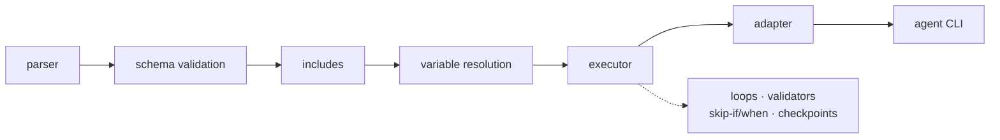

# agent-yaml

Define repeatable workflows once, in YAML, and run them through OpenCode, Claude Code, Gemini, Qwen,
or Codex. The workflow is built from shared primitives (loops, validators, variables, includes,
checkpoints) and does not depend on any one harness.

A prompt you retype is a one-off. A YAML file with a task tree, a loop source, a validation rule and
a checkpoint is a job you can rerun, review, hand to a teammate, and point at a different agent CLI
without rewriting it.



## Why it exists

- **Repeatable work should be a file, not a ritual.** The workflow file is the run definition: same
  task tree, same loop sources, same validators, every time. Rerunning it is the normal case, not a
  re-derivation from chat history.
- **Shared primitives across agents.** Loops, validators, template variables, includes, `ensure` and
  checkpoints mean the same thing whether the task runs under OpenCode, Claude Code, Gemini, Qwen or
  Codex. Adapters translate config keys into each CLI's flags, so switching agents does not change
  the workflow.
- **No harness lock-in.** You bring the agent CLI you already use. agent-yaml does not wrap a vendor
  SDK or require a specific plugin system. Each step is one subprocess call, and the only contract
  between steps is files on disk.
- **The model's prose is not an API.** agent-yaml never parses agent output. Steps succeed by writing
  files that validators can check, so a run that "looks done" fails loudly when it isn't.
- **You can see the command before it costs anything.** `--dry-run` prints the exact argv for every
  task and calls no model.

## Install

No PyPI release yet. Install from the repository:

```bash
pip install "git+https://github.com/roboalchemist/agent-yaml.git"
agent-yaml --help
```

Python 3.8+ (developed and tested on 3.12), plus at least one supported agent CLI on `PATH`
(`opencode`, `claude`, `gemini`, `qwen`, or `codex`).

## Quick start

```yaml
# hello.yaml
directory: /tmp/hello
cli-agent: opencode
cli-agent-config:
  skip-confirmations: true
  model: provider/model-name

task:
  - write-file:
      prompt: "Create hello.txt containing exactly: hello from agent-yaml"
```

```bash
mkdir -p /tmp/hello
agent-yaml validate hello.yaml        # parse and schema check, no agent calls
agent-yaml run hello.yaml --dry-run   # print the exact command that would run
agent-yaml run hello.yaml             # run it
```

A dry run for that file prints the command it would execute, including the translated flags, so you
can spot a wrong model or a rejected option before spending tokens:

```
[DRY RUN] Task 'write-file' would execute:
  Command: opencode run --standalone --auto -- Create hello.txt containing exactly: ...
  Working directory: /tmp/hello
```

## A real workflow

This is the shape of the workflows in `examples/` and `tasks/`: a CSV loop, a validator per item,
retries on validation failure, and a checkpoint so an interrupted run can continue.

```yaml
directory: ~/projects/reports
cli-agent-config:
  model: openai/gpt-5

task:
  - summarize-rows:
      loop:
        type: csv
        source: "{{directory}}/rows.csv"
        workers: 4
        retry: {max-attempts: 3, on-failure: retry}
        checkpoint-file: "{{directory}}/state/summaries.json"
        resume: true
      prompt: |
        Summarize row {{loop.index}}/{{loop.total}} ({{loop.item.name}}) and write
        {{directory}}/out/{{loop.item.name}}.md
      validate:
        - file-not-empty: "{{directory}}/out/{{loop.item.name}}.md"
```

Run it, and rerun the same command after an interruption. Finished items are skipped.

## How a run works

1. **Parse** (`src/parser.py`) the YAML with `yaml.safe_load`.
2. **Validate** (`src/validator.py`) required fields, task-tree shape, loop, validator, skip-if,
   when, and retry configuration, plus adapter option names.
3. **Resolve includes** (`src/includes.py`) and **variables** (`src/variables.py`,
   `src/utils.py`). Reserved variables are injected, user variables resolve in dependency order,
   and cycles are rejected.
4. **Check prerequisites** (`src/ensure.py`) with `shutil.which` before anything runs.
5. **Execute** (`src/executor.py`) the task tree. Array items run in order, mapping keys run
   concurrently in a `ThreadPoolExecutor`, and each task is one `subprocess.run` with a timeout.
6. **Validate output**, then run the loop's next item or checkpoint its progress.

## Watch it run

`agent-yaml serve` starts a local console for browsing, running, and watching workflows:

```bash
agent-yaml serve --host 127.0.0.1 --port 8765
```

It discovers `*.yaml` under `examples/` and `tasks/`, draws the stage graph on a WebGL2 canvas,
streams execution events over SSE, and stores runs plus interval/cron schedules in SQLite. Details
and the HTTP API are in [docs/INTERFACE_RUNNER.md](docs/INTERFACE_RUNNER.md).

## Pick your agent

| Adapter | Skip confirmations | Model flag |
|---------|--------------------|------------|
| `opencode` | `--auto` | `--model provider/model` |
| `claude` | `--dangerously-skip-permissions` | `--model` (aliases translated) |
| `gemini` | `--yolo` | `--model` |
| `qwen` | `--yolo` | `--model` |
| `codex` | `--full-auto` | `-m` |

Common options (`model`, `timeout`, `skip-confirmations`, `additional-dirs`, `mcp-config-file`,
`debug`, `raw-args`, `output-format`) map to each CLI. See
[docs/ADAPTER_TROUBLESHOOTING.md](docs/ADAPTER_TROUBLESHOOTING.md) for the full per-adapter table
and [spec/ADAPTER_SPEC.md](spec/ADAPTER_SPEC.md) for the contract.

## Docs

- [docs/](docs/README.md) is the field-level reference: authoring, templating, loops, parallel
  loops, validators, interface runner, adapters.
- [docs/CLI.md](docs/CLI.md) covers every flag, exit code, environment precedence, and retry
  behaviour.
- [examples/](examples/README.md) has 40+ runnable workflows, all dry-run by the test suite.
- [spec/](spec/) holds the authoritative schema and adapter specs.

## Development

```bash
pip install -e ".[dev]"   # pytest, ruff, coverage
pytest -q                 # hermetic, no model calls
ruff check src tests
pip install -e ".[docs]"  # mkdocs
mkdocs serve              # preview docs/ at http://127.0.0.1:8000
```

The test suite is three tiers: unit (agent mocked), integration (a fake `opencode` that runs the
prompt's `bash` block), and live (`pytest --live`, a real model behind an OpenAI-compatible
gateway). See [tests/README.md](tests/README.md).

## What it doesn't do

- It does not parse or judge model output. If a step needs to prove something, give it a validator.
- MCP detection in `ensure.mcps` is a warning-only stub.
- Nested list tasks (`task: [...]` inside a task) are rejected by the validator even though
  `spec/YAML_SPEC.md` documents them. Use the mapping form.
- `agent-yaml run --resume` is a no-op. Resumption happens through each loop's `resume: true` plus
  `checkpoint-file`.
- The Codex adapter emits flags that recent `codex-cli` releases reject. The Claude adapter sends
  `--allowed-mcp-server-names`, which current `claude` builds reject. Both are listed with workarounds
  in [docs/ADAPTER_TROUBLESHOOTING.md](docs/ADAPTER_TROUBLESHOOTING.md).
- Cancellation is best effort: in a parallel group with `on-error: fail`, tasks already scheduled
  still run before the workflow aborts.

## Contributing

See [CONTRIBUTING.md](CONTRIBUTING.md). Bug reports and pull requests are welcome.

## License

[MIT](LICENSE) © 2026 Joe Schlesinger
